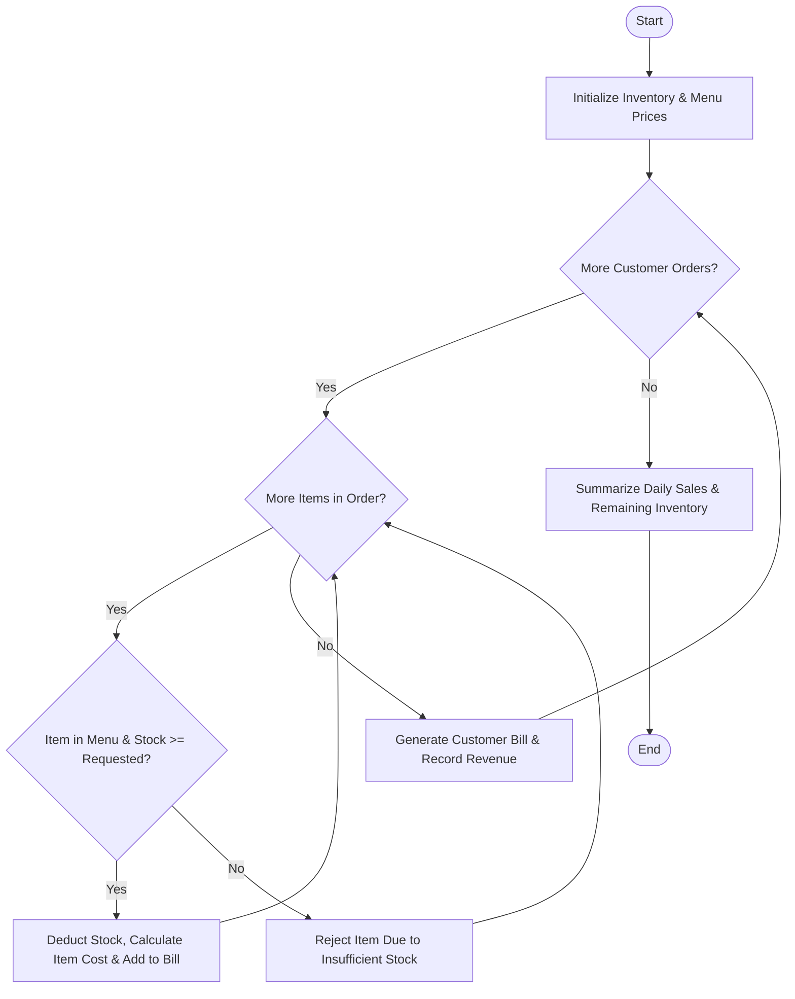

Here is a complete system design, algorithm, Mermaid flowchart, comment-free Python implementation, and sample test case for the **Smart Canteen Order and Stock Management System**.

---

## 1. Problem Statement

School, college, and corporate canteens require real-time inventory tracking combined with automated order processing to prevent stockouts, eliminate manual billing errors, and handle partial or full order rejections when items exceed available supplies.

The system must process successive customer orders against live inventory levels, calculate itemized bills, automatically deduct fulfilled items from stock, reject unavailable quantities with descriptive feedback, and generate an end-of-day revenue and remaining stock summary.

### **Rules & Mechanics:**

1. **Inventory Validation:** Each ordered item is checked against available stock.
2. **Fulfillment & Billing:** If stock is sufficient, the quantity is deducted from inventory, sales are recorded, and item costs are added to the bill.
3. **Rejection Handling:** If the requested quantity exceeds available stock (or the item is not on the menu), that specific item is rejected while processing the rest of the order.
4. **Daily Summarization:** Aggregates total daily revenue, units sold per menu item, and closing inventory counts.

---

## 2. Algorithm

1. **Initialize Inputs:** Load menu item prices, initial inventory stock levels, and incoming customer order queues.
2. **Process Customer Orders:**
* For each customer order, initialize a bill container and a rejection log.
* For each requested item and quantity:
* Check if the item exists in the menu.
* Check if `requested_quantity <= available_stock`.
* If available, deduct the quantity from inventory, update units sold, and calculate the cost.
* If unavailable, record the rejection reason.


* Compute total order cost and store fulfillment details.


3. **Generate Summary:** Accumulate total daily revenue and format the end-of-day inventory and sales report.

---

## 3. Flowchart (Mermaid)



---

## 4. Python Source Code (Without Comments)

```python
class CanteenSystem:
    def __init__(self, menu_prices, initial_stock):
        self.menu_prices = menu_prices
        self.inventory = initial_stock
        self.total_revenue = 0.0
        self.items_sold_summary = {item: 0 for item in initial_stock}

    def process_orders(self, customer_orders):
        daily_reports = []

        for order_idx, order in enumerate(customer_orders, 1):
            customer_name = order["customer_name"]
            cart = order["items"]
            
            bill_items = []
            order_total = 0.0
            rejections = []

            for item_name, qty in cart.items():
                if item_name not in self.menu_prices:
                    rejections.append(f"{item_name}: Item not on menu")
                    continue
                
                available = self.inventory.get(item_name, 0)
                if qty <= available:
                    self.inventory[item_name] -= qty
                    self.items_sold_summary[item_name] += qty
                    item_cost = self.menu_prices[item_name] * qty
                    order_total += item_cost
                    bill_items.append({"name": item_name, "qty": qty, "cost": item_cost})
                else:
                    rejections.append(f"{item_name}: Requested {qty}, only {available} available")

            self.total_revenue += order_total
            
            daily_reports.append({
                "order_id": f"ORD-{100 + order_idx}",
                "customer": customer_name,
                "bill_items": bill_items,
                "order_total": order_total,
                "rejections": rejections
            })

        return daily_reports

    def generate_daily_summary(self, daily_reports):
        summary = f"""
==================================================
        SMART CANTEEN DAILY OPERATIONS REPORT
==================================================
TOTAL DAILY REVENUE : ₹{self.total_revenue:,.2f}
--------------------------------------------------
ORDER FULFILLMENT LOG
--------------------------------------------------"""

        for rep in daily_reports:
            summary += f"\n- Order ID: {rep['order_id']} | Customer: {rep['customer']}"
            if rep['bill_items']:
                for bi in rep['bill_items']:
                    summary += f"\n  * {bi['name']} x {bi['qty']} = ₹{bi['cost']:,.2f}"
                summary += f"\n  Order Total: ₹{rep['order_total']:,.2f}"
            else:
                summary += f"\n  Order fully unfulfilled."
            if rep['rejections']:
                summary += f"\n  Rejections: {'; '.join(rep['rejections'])}"

        summary += f"""
--------------------------------------------------
REMAINING INVENTORY STOCK
--------------------------------------------------"""

        for item, qty in self.inventory.items():
            sold = self.items_sold_summary[item]
            summary += f"\n- {item:<15} : {qty} units remaining (Sold: {sold})"

        summary += "\n=================================================="
        return summary

if __name__ == "__main__":
    menu_prices = {
        "Veg Burger": 120.0,
        "Cheese Pizza": 250.0,
        "Cold Coffee": 90.0,
        "French Fries": 80.0,
        "Club Sandwich": 150.0
    }

    initial_stock = {
        "Veg Burger": 15,
        "Cheese Pizza": 5,
        "Cold Coffee": 20,
        "French Fries": 10,
        "Club Sandwich": 8
    }

    canteen = CanteenSystem(menu_prices, initial_stock)

    customer_orders = [
        {
            "customer_name": "Aarav Sharma",
            "items": {"Veg Burger": 2, "Cold Coffee": 2, "French Fries": 3}
        },
        {
            "customer_name": "Priya Nair",
            "items": {"Cheese Pizza": 4, "Club Sandwich": 2}
        },
        {
            "customer_name": "Rohan Gupta",
            "items": {"Cheese Pizza": 3, "Veg Burger": 15}
        }
    ]

    reports = canteen.process_orders(customer_orders)
    print(canteen.generate_daily_summary(reports))

```

---

## 5. Sample Input & Output

### **Sample Input Configuration**

* **Menu & Prices:** Veg Burger (₹120), Cheese Pizza (₹250), Cold Coffee (₹90), French Fries (₹80), Club Sandwich (₹150)
* **Initial Inventory:** Veg Burger (15), Cheese Pizza (5), Cold Coffee (20), French Fries (10), Club Sandwich (8)
* **Customer Orders:**
1. *Aarav Sharma*: 2 Veg Burgers, 2 Cold Coffees, 3 French Fries
2. *Priya Nair*: 4 Cheese Pizzas, 2 Club Sandwiches
3. *Rohan Gupta*: 3 Cheese Pizzas, 15 Veg Burgers (Exceeds remaining stock)


---

### **Sample Output Operations Report**

```text
==================================================
        SMART CANTEEN DAILY OPERATIONS REPORT
==================================================
TOTAL DAILY REVENUE : ₹2,070.00
--------------------------------------------------
ORDER FULFILLMENT LOG
--------------------------------------------------
- Order ID: ORD-101 | Customer: Aarav Sharma
  * Veg Burger x 2 = ₹240.00
  * Cold Coffee x 2 = ₹180.00
  * French Fries x 3 = ₹240.00
  Order Total: ₹660.00
- Order ID: ORD-102 | Customer: Priya Nair
  * Cheese Pizza x 4 = ₹1,000.00
  * Club Sandwich x 2 = ₹300.00
  Order Total: ₹1,300.00
- Order ID: ORD-103 | Customer: Rohan Gupta
  * Cheese Pizza x 3 = ₹750.00
  Order Total: ₹750.00
  Rejections: Veg Burger: Requested 15, only 13 available
--------------------------------------------------
REMAINING INVENTORY STOCK
--------------------------------------------------
- Veg Burger      : 13 units remaining (Sold: 2)
- Cheese Pizza    : 0 units remaining (Sold: 7)
- Cold Coffee     : 18 units remaining (Sold: 2)
- French Fries    : 7 units remaining (Sold: 3)
- Club Sandwich   : 6 units remaining (Sold: 2)
==================================================

```
