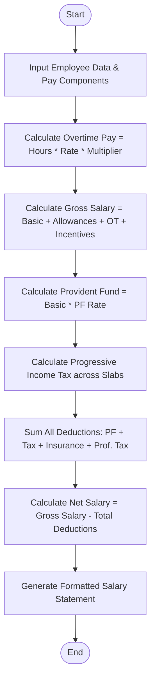

Here is a complete system design, algorithm, Mermaid flowchart, Python implementation, and sample test case for the **Employee Payroll and Deduction Analysis System**.

---

## 1. Problem Statement

Organizations need a reliable payroll management system to calculate monthly or periodic employee compensation accurately. The system must process multiple earnings components (basic pay, allowances, overtime, and performance incentives), apply statutory and progressive deductions (such as tiered income tax brackets, provident fund, and insurance), and generate a clean, itemized salary statement.

### **Components & Rules:**

1. **Earnings:**
* **Gross Salary:** Sum of Basic Pay, Allowances, Overtime Pay, and Incentives.
* **Overtime Pay:** Overtime Hours $\times$ Hourly Rate $\times$ Overtime Multiplier.


2. **Deductions:**
* **Provident Fund (PF):** A fixed percentage of the Basic Pay.
* **Professional Tax / Insurance:** Fixed standard deductions.
* **Progressive Income Tax:** Tiered tax calculation based on taxable income thresholds (e.g., higher income slabs are taxed at higher marginal rates).


3. **Net Salary:** Gross Salary minus Total Deductions.

---

## 2. Algorithm

1. **Initialize Inputs:** Retrieve employee details, basic pay, allowances, overtime hours, hourly rate, incentives, and deduction parameters.
2. **Calculate Gross Earnings:**
* Compute `Overtime Pay = Overtime Hours * Hourly Rate * Multiplier`.
* Compute `Gross Salary = Basic Pay + Allowances + Overtime Pay + Incentives`.


3. **Calculate Standard Deductions:**
* Compute `Provident Fund (PF) = Basic Pay * PF Rate`.
* Add fixed deductions like Professional Tax and Health Insurance.


4. **Calculate Progressive Income Tax:**
* Determine taxable base.
* Iterate through tax brackets (e.g., 0% up to limit A, 10% between limit A and B, 20% above limit B) and accumulate tax across slabs.


5. **Calculate Net Salary:**
* `Total Deductions = PF + Professional Tax + Insurance + Income Tax`
* `Net Salary = Gross Salary - Total Deductions`


6. **Format Statement:** Generate and print an itemized salary breakdown sheet.

---

## 3. Flowchart (Mermaid)



---

## 5. Sample Input & Output

### **Sample Input Data**

* **Employee ID:** `EMP-4021`
* **Name:** Sarah Jenkins
* **Basic Pay:** ₹55,000.00
* **Allowances:** ₹18,000.00
* **Overtime Hours:** 12 hours (at ₹350/hr with 1.5x multiplier)
* **Incentives:** ₹7,500.00
* **Standard Deductions Config:**
* PF Rate: $12\%$ of Basic Pay
* Professional Tax: ₹200.00
* Health Insurance: ₹1,500.00


---

### **Sample Output Statement**

```text
==================================================
              SALARY STATEMENT
==================================================
Employee ID   : EMP-4021
Employee Name : Sarah Jenkins
Designation   : Senior Software Engineer
--------------------------------------------------
EARNINGS                                AMOUNT (₹)
--------------------------------------------------
Basic Pay                          : ₹55,000.00
Allowances (HRA/DA)                : ₹18,000.00
Overtime (12 hrs @ ₹350/hr)        : ₹6,300.00
Performance Incentives             : ₹7,500.00
--------------------------------------------------
GROSS SALARY                       : ₹86,800.00
==================================================
DEDUCTIONS                              AMOUNT (₹)
--------------------------------------------------
Provident Fund (PF)                : ₹6,600.00
Professional Tax                   : ₹200.00
Health Insurance                   : ₹1,500.00
Progressive Income Tax             : ₹7,040.00
--------------------------------------------------
TOTAL DEDUCTIONS                   : ₹15,340.00
==================================================
NET TAKE-HOME SALARY               : ₹71,460.00
==================================================

```
