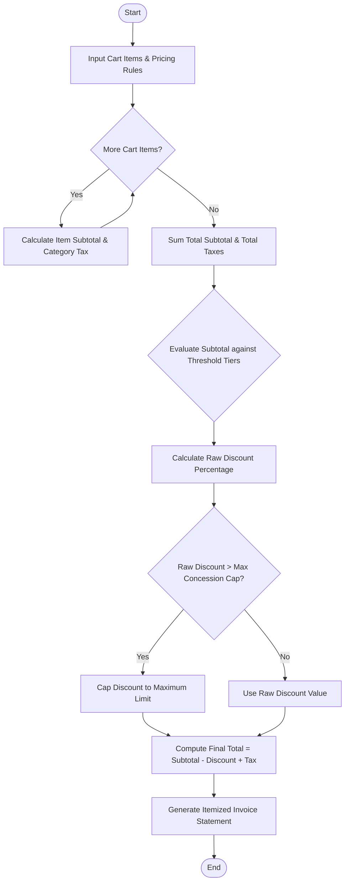

Here is a complete system design, algorithm, Mermaid flowchart, Python implementation, and sample test case for the **Retail Billing with Multiple Discount Rules** system.

---

## 1. Problem Statement

Modern retail checkout and invoicing systems require sophisticated calculation engines that handle heterogeneous product categories, dynamic tax structures, conditional promotional discounts, and safety caps to prevent excessive revenue loss.

The system must process a shopping cart containing multiple items, apply category-specific taxes, evaluate tiered threshold discounts based on the purchase subtotal, enforce a maximum concession limit (cap) on total discounts, and generate a clean, itemized invoice.

### **Rules & Constraints:**

1. **Category-Specific Taxes:** Different product categories attract different tax rates (e.g., Groceries: 5%, Electronics: 18%, Clothing: 12%).
2. **Threshold Discounts:** Progressive discount rates based on total subtotal value (e.g., Orders over ₹5,000 get 5% off; orders over ₹10,000 get 10% off).
3. **Maximum Concession Limit:** A safety cap that restricts the maximum total discount amount a customer can receive in a single transaction (e.g., capped at ₹1,500).
4. **Final Bill Computation:** $\text{Final Total} = \text{Subtotal} - \text{Applied Discount} + \text{Total Taxes}$.

---

## 2. Algorithm

1. **Initialize Inputs:** Load cart items (product name, category, unit price, quantity) and system rules (tax rates, discount tiers, max discount cap).
2. **Calculate Item Subtotals & Taxes:**
* For each item, compute `Item Subtotal = Unit Price * Quantity`.
* Look up the category tax rate and compute `Item Tax = Item Subtotal * Tax Rate`.
* Accumulate total subtotal and total taxes.


3. **Evaluate Threshold Discounts:**
* Compare total subtotal against configured spending thresholds in descending order.
* Determine the applicable discount percentage.
* Calculate `Raw Discount = Subtotal * Discount Percentage`.


4. **Enforce Maximum Concession Limit:**
* Compare `Raw Discount` against the maximum allowable discount cap.
* If `Raw Discount > Max Cap`, set `Final Discount = Max Cap`. Otherwise, `Final Discount = Raw Discount`.


5. **Compute Net Total:**
* `Net Payable = Subtotal - Final Discount + Total Tax`.


6. **Generate Invoice:** Format and print the itemized bill statement.

---

## 3. Flowchart (Mermaid)



---


## 5. Sample Input & Output

### **Sample Input Configuration**

* **Customer Name:** Rohan Malhotra
* **Cart Items:**
1. Wireless Earbuds (`Electronics`): 2 units @ ₹2,500.00 each
2. Organic Rice 5kg (`Groceries`): 3 units @ ₹600.00 each
3. Cotton Denim Jeans (`Clothing`): 2 units @ ₹1,800.00 each


* **Tax Rules:** Groceries (5%), Clothing (12%), Electronics (18%)
* **Discount Tiers:**
* Subtotal $\ge$ ₹10,000 $\rightarrow$ 15% discount
* Subtotal $\ge$ ₹5,000 $\rightarrow$ 8% discount


* **Maximum Concession Limit:** ₹1,200.00 cap

---

### **Sample Output Invoice**

```text
==================================================
              RETAIL TAX INVOICE
==================================================
Customer Name : Rohan Malhotra
--------------------------------------------------
ITEM DESCRIPTION        QTY  UNIT(₹)   TOTAL(₹)   TAX(₹)
--------------------------------------------------
Wireless Earbuds     2    ₹2500.00  ₹5000.00    ₹900.00
Organic Rice (5kg)   3    ₹600.00   ₹1800.00    ₹90.00
Cotton Denim Jeans   2    ₹1800.00  ₹3600.00    ₹432.00
--------------------------------------------------
SUBTOTAL                               : ₹10,400.00
Threshold Discount Applied (15.0%)     : -₹1,560.00
[NOTE: Discount capped at maximum limit of ₹1,200.00]
FINAL DISCOUNT AMOUNT                  : -₹1,200.00
TOTAL TAX                              : +₹1,422.00
==================================================
NET PAYABLE AMOUNT                     : ₹10,622.00
==================================================

```
