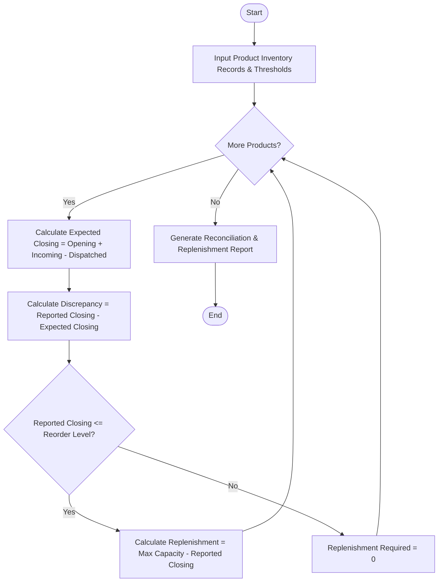

Here is a complete system design, algorithm, Mermaid flowchart, Python implementation, and sample test case for the **Warehouse Inventory Reconciliation System**.

---

## 1. Problem Statement

Warehouses handle thousands of items daily, making inventory shrinkage, unrecorded damages, counting errors, and stockouts major operational risks. An automated inventory reconciliation system is required to compare physical audit counts (reported closing stock) against calculated system expectations (opening stock + incoming shipments - dispatched orders), detect discrepancies, and compute automated replenishment orders when stock falls below pre-defined safety thresholds.

### **Rules & Mechanics:**

1. **Expected Stock Calculation:** $\text{Expected Closing} = \text{Opening Stock} + \text{Incoming} - \text{Dispatched}$.
2. **Discrepancy Detection:** $\text{Discrepancy} = \text{Reported Closing Stock} - \text{Expected Closing}$.
* *Positive Discrepancy:* Surplus inventory (unrecorded stock found during audit).
* *Negative Discrepancy:* Shrinkage/loss (missing stock due to theft, damage, or miscount).
* *Zero Discrepancy:* Perfect match.


3. **Replenishment Analysis:** If $\text{Reported Closing Stock} \le \text{Reorder Level}$, calculate the necessary replenishment quantity to restore inventory to the target maximum stock level.

---

## 2. Algorithm

1. **Initialize Inputs:** Load warehouse inventory records including product ID, name, opening stock, incoming quantities, dispatched quantities, reported physical closing stock, reorder level, and maximum stock capacity.
2. **Process Each Product:**
* Compute `Expected Closing Stock = Opening + Incoming - Dispatched`.
* Compute `Discrepancy = Reported Closing - Expected Closing`.
* Evaluate `Discrepancy Status` (Balanced, Shrinkage/Loss, or Surplus).


3. **Evaluate Replenishment Requirements:**
* Check if `Reported Closing <= Reorder Level`.
* If true, calculate `Replenishment Quantity = Maximum Capacity - Reported Closing`. Otherwise, replenishment is 0.


4. **Generate Audit & Replenishment Report:** Compile all itemized metrics into a structured summary statement.

---

## 3. Flowchart (Mermaid)



---

## 4. Python Source Code

```python
class InventoryReconciliationSystem:
    def __init__(self):
        pass

    def reconcile_inventory(self, warehouse_name, products):
        reconciliation_records = []
        total_discrepancies_found = 0
        total_replenishment_units = 0

        for prod in products:
            prod_id = prod['product_id']
            name = prod['name']
            opening = prod['opening_stock']
            incoming = prod['incoming']
            dispatched = prod['dispatched']
            reported_closing = prod['reported_closing']
            reorder_level = prod['reorder_level']
            max_capacity = prod['max_capacity']

            # 1. Calculate Expected Closing Stock
            expected_closing = opening + incoming - dispatched

            # 2. Detect Discrepancy
            discrepancy = reported_closing - expected_closing
            if discrepancy != 0:
                total_discrepancies_found += 1

            # Determine discrepancy status text
            if discrepancy > 0:
                disc_status = f"Surplus (+{discrepancy})"
            elif discrepancy < 0:
                disc_status = f"Shrinkage ({discrepancy}) ⚠️"
            else:
                disc_status = "Balanced ✅"

            # 3. Calculate Replenishment Requirements
            replenishment_qty = 0
            if reported_closing <= reorder_level:
                replenishment_qty = max(0, max_capacity - reported_closing)
                total_replenishment_units += replenishment_qty

            reconciliation_records.append({
                "product_id": prod_id,
                "name": name,
                "expected": expected_closing,
                "reported": reported_closing,
                "discrepancy": discrepancy,
                "disc_status": disc_status,
                "needs_reorder": reported_closing <= reorder_level,
                "replenishment_qty": replenishment_qty
            })

        # 4. Generate Formatted Reconciliation Report
        report = f"""
==================================================
        WAREHOUSE INVENTORY RECONCILIATION
==================================================
Warehouse Location : {warehouse_name}
Total Items Audited: {len(products)}
Discrepancies Flagged: {total_discrepancies_found}
--------------------------------------------------
ITEM AUDIT BREAKDOWN
--------------------------------------------------"""

        for r in reconciliation_records:
            report += f"""
- [{r['product_id']}] {r['name']}
  Expected Closing : {r['expected']} | Reported Audit: {r['reported']}
  Discrepancy      : {r['disc_status']}"""
            if r['needs_reorder']:
                report += f"\n  REPLENISHMENT    : Order {r['replenishment_qty']} units (Below reorder threshold) 🚨"
            else:
                report += f"\n  REPLENISHMENT    : Stock levels healthy"

        report += f"""
--------------------------------------------------
SUMMARY ACTIONS REQUIRED
--------------------------------------------------
Total Reorder Purchase Orders Triggered : {sum(1 for r in reconciliation_records if r['needs_reorder'])} Products
Total Units Needed for Replenishment    : {total_replenishment_units:,} units
==================================================
"""
        return report

# ==========================================
# Sample Execution
# ==========================================
if __name__ == "__main__":
    system = InventoryReconciliationSystem()
    
    # Sample Warehouse Inventory Input Data
    warehouse_stock = [
        {
            "product_id": "P-101",
            "name": "Wireless Mechanical Keyboard",
            "opening_stock": 150,
            "incoming": 200,
            "dispatched": 180,
            "reported_closing": 165,  # Expected: 150 + 200 - 180 = 170 (Discrepancy: -5 missing)
            "reorder_level": 50,
            "max_capacity": 300
        },
        {
            "product_id": "P-102",
            "name": "HD 27-inch Monitor",
            "opening_stock": 45,
            "incoming": 30,
            "dispatched": 60,
            "reported_closing": 15,   # Expected: 45 + 30 - 60 = 15 (Balanced)
            "reorder_level": 25,       # Below reorder level -> Triggers replenishment
            "max_capacity": 100
        },
        {
            "product_id": "P-103",
            "name": "USB-C Fast Charging Cable",
            "opening_stock": 500,
            "incoming": 1000,
            "dispatched": 1250,
            "reported_closing": 255,  # Expected: 500 + 1000 - 1250 = 250 (Discrepancy: +5 surplus)
            "reorder_level": 100,
            "max_capacity": 800
        },
        {
            "product_id": "P-104",
            "name": "Ergonomic Office Chair",
            "opening_stock": 30,
            "incoming": 10,
            "dispatched": 35,
            "reported_closing": 5,    # Expected: 30 + 10 - 35 = 5 (Balanced)
            "reorder_level": 15,       # Triggers replenishment
            "max_capacity": 50
        }
    ]
    
    print(system.reconcile_inventory("Central Distribution Hub - North", warehouse_stock))

```

---

## 5. Sample Input & Output

### **Sample Input Configuration**

* **Warehouse Location:** `Central Distribution Hub - North`
* **Inventory Records:**
1. *Wireless Mechanical Keyboard* (`P-101`): Opening = 150, Incoming = 200, Dispatched = 180, Reported = 165, Reorder Level = 50, Max Capacity = 300
2. *HD 27-inch Monitor* (`P-102`): Opening = 45, Incoming = 30, Dispatched = 60, Reported = 15, Reorder Level = 25, Max Capacity = 100
3. *USB-C Fast Charging Cable* (`P-103`): Opening = 500, Incoming = 1000, Dispatched = 1250, Reported = 255, Reorder Level = 100, Max Capacity = 800
4. *Ergonomic Office Chair* (`P-104`): Opening = 30, Incoming = 10, Dispatched = 35, Reported = 5, Reorder Level = 15, Max Capacity = 50


---

### **Sample Output Report**

```text
==================================================
        WAREHOUSE INVENTORY RECONCILIATION
==================================================
Warehouse Location : Central Distribution Hub - North
Total Items Audited: 4
Discrepancies Flagged: 2
--------------------------------------------------
ITEM AUDIT BREAKDOWN
--------------------------------------------------
- [P-101] Wireless Mechanical Keyboard
  Expected Closing : 170 | Reported Audit: 165
  Discrepancy      : Shrinkage (-5) ⚠️
  REPLENISHMENT    : Stock levels healthy
- [P-102] HD 27-inch Monitor
  Expected Closing : 15 | Reported Audit: 15
  Discrepancy      : Balanced ✅
  REPLENISHMENT    : Order 85 units (Below reorder threshold) 🚨
- [P-103] USB-C Fast Charging Cable
  Expected Closing : 250 | Reported Audit: 255
  Discrepancy      : Surplus (+5)
  REPLENISHMENT    : Stock levels healthy
- [P-104] Ergonomic Office Chair
  Expected Closing : 5 | Reported Audit: 5
  Discrepancy      : Balanced ✅
  REPLENISHMENT    : Order 45 units (Below reorder threshold) 🚨
--------------------------------------------------
SUMMARY ACTIONS REQUIRED
--------------------------------------------------
Total Reorder Purchase Orders Triggered : 2 Products
Total Units Needed for Replenishment    : 130 units
==================================================

```
