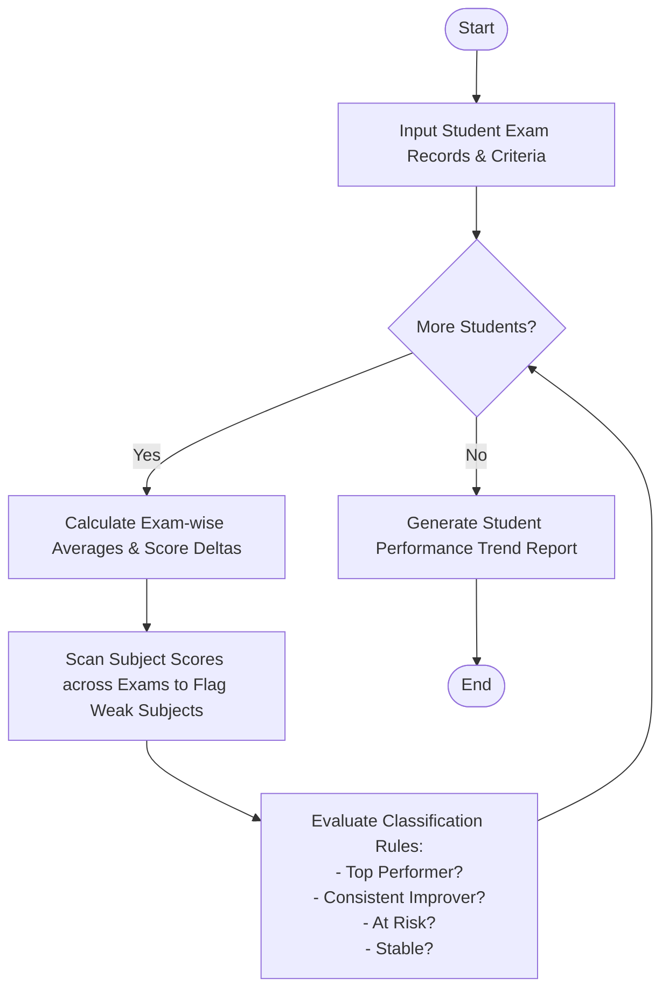

Here is a complete system design, algorithm, Mermaid flowchart, Python implementation, and sample test case for the **Student Performance Trend Analysis System**.

---

## 1. Problem Statement

Educational institutions need to monitor student academic progression across multiple examinations and subjects to provide timely interventions. A manual review of disparate test scores makes it difficult to spot longitudinal trends, persistent learning gaps, or acute performance drops.

An automated trend analysis system is required to compare assessment scores across multiple sequential examinations, calculate score deltas (improvements or declines), identify consistently weak subjects based on threshold scores, and classify students into performance categories (e.g., *Top Performer*, *Consistent Improver*, *At Risk/Declining*, or *Stable*).

### **Rules & Criteria:**

1. **Trend Calculation:** Compare consecutive examination totals/averages to determine if a student is improving, declining, or remaining stable.
2. **Weak Subject Identification:** A subject is flagged as "weak" if a student scores below a passing threshold (e.g., $< 60$) in two or more examinations.
3. **Student Classification:**
* **Top Performer:** Overall average $\ge 85.0$ with no weak subjects.
* **Consistent Improver:** Average score strictly increases across sequential examinations.
* **At Risk:** Overall average $< 60.0$ or has 2 or more consistently weak subjects.
* **Stable/Average:** Students who do not meet extreme classification criteria.


---

## 2. Algorithm

1. **Initialize Inputs:** Load student records, examination names, subject lists, and classification thresholds.
2. **Process Each Student's Exam History:**
* Compute individual examination averages or totals.
* Calculate score deltas between consecutive exams to track improvement or decline.


3. **Identify Weak Subjects:**
* Iterate through subject-wise scores across all exams.
* Flag subjects where scores fall below the minimum threshold $\ge 2$ times.


4. **Classify Student Performance:**
* Apply classification rules based on overall averages, score trajectories, and weak subject counts.


5. **Generate Comprehensive Trend Report:** Compile metrics, trends, weaknesses, and classifications into a structured statement.

---

## 3. Flowchart (Mermaid)



---


## 5. Sample Input & Output

### **Sample Input Configuration**

* **Passing Threshold:** `60.0`
* **Top Performer Cutoff:** `85.0` Average
* **Students Data:**
1. *Elena Rostova* (`ST-201`): Consistently high scores showing academic excellence.
2. *Marcus Vance* (`ST-202`): Progressing upwards across exams (`Midterm 1` $\rightarrow$ `Midterm 2` $\rightarrow$ `Final Exam`).
3. *Chloe Bennett* (`ST-203`): Struggling in Math and Physics across multiple tests.
4. *Liam O'Connor* (`ST-204`): Consistent mid-range scores with minimal fluctuation.


---

### **Sample Output Report**

```text
==================================================
        STUDENT PERFORMANCE TREND ANALYSIS
==================================================
Total Students Evaluated : 4
Passing Threshold        : 60.0 Marks
Top Performer Cutoff     : 85.0 Average
--------------------------------------------------
- [ST-201] Elena Rostova
  Overall Average Score : 91.56%
  Classification Status : Top Performer 🌟
  Weak Subjects Flagged : None
  Exam Progress Breakdown :
    * Midterm 1: Avg 87.7% | Scores: {'Math': 88, 'Physics': 85, 'Literature': 90}
    * Midterm 2: Avg 91.7% | Scores: {'Math': 92, 'Physics': 89, 'Literature': 94}
    * Final Exam: Avg 95.7% | Scores: {'Math': 95, 'Physics': 94, 'Literature': 98}

- [ST-202] Marcus Vance
  Overall Average Score : 70.44%
  Classification Status : Consistent Improver 📈
  Weak Subjects Flagged : None
  Exam Progress Breakdown :
    * Midterm 1: Avg 64.3% | Scores: {'Math': 65, 'Physics': 58, 'Literature': 70}
    * Midterm 2: Avg 70.3% | Scores: {'Math': 72, 'Physics': 64, 'Literature': 75}
    * Final Exam: Avg 79.0% | Scores: {'Math': 80, 'Physics': 75, 'Literature': 82}

- [ST-203] Chloe Bennett
  Overall Average Score : 51.00%
  Classification Status : At Risk ⚠️
  Weak Subjects Flagged : Math, Physics
  Exam Progress Breakdown :
    * Midterm 1: Avg 52.3% | Scores: {'Math': 52, 'Physics': 45, 'Literature': 60}
    * Midterm 2: Avg 51.0% | Scores: {'Math': 48, 'Physics': 50, 'Literature': 55}
    * Final Exam: Avg 47.7% | Scores: {'Math': 45, 'Physics': 40, 'Literature': 58}

- [ST-204] Liam O'Connor
  Overall Average Score : 77.56%
  Classification Status : Stable / Satisfactory ⚖️
  Weak Subjects Flagged : None
  Exam Progress Breakdown :
    * Midterm 1: Avg 77.7% | Scores: {'Math': 78, 'Physics': 80, 'Literature': 75}
    * Midterm 2: Avg 77.3% | Scores: {'Math': 76, 'Physics': 79, 'Literature': 77}
    * Final Exam: Avg 78.0% | Scores: {'Math': 77, 'Physics': 81, 'Literature': 76}
==================================================

```
