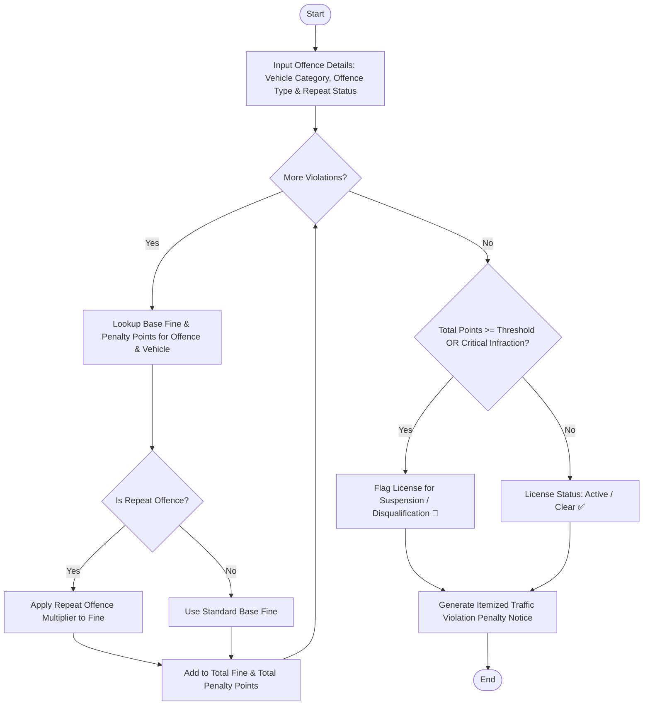

Here is a complete system design, algorithm, Mermaid flowchart, Python implementation, and sample test case for the **Traffic Violation Penalty Calculator**.

---

## 1. Problem Statement

Traffic management authorities require an automated penalty calculation system to process vehicle infractions efficiently. The system must evaluate violations based on the vehicle category (e.g., Two-Wheeler, Car, Heavy Commercial Vehicle), the specific offence type (e.g., Speeding, Red Light, No Helmet/Seatbelt, Driving Without License), whether it is a repeat offence, and predefined statutory fine schedules.

Additionally, the system must check for license disqualification or suspension conditions based on accumulated penalty points or severe statutory violations.

### **Rules & Mechanics:**

1. **Base Fine Rules:** Fines vary by vehicle category and offence severity.
2. **Repeat Offence Multiplier:** If the offender has committed the same offence previously within a specified window, a repeat multiplier (e.g., $1.5\times$ or $2\times$) is applied to the base fine.
3. **Penalty Points:** Each violation accrues penalty points (e.g., Speeding = 3 points, Reckless Driving = 6 points).
4. **Disqualification Conditions:** A driver's license is flagged for suspension/disqualification if:
* Total accumulated penalty points exceed a critical limit (e.g., $\ge 12$ points).
* The offence involves a critical zero-tolerance infraction (e.g., Hit-and-Run or extreme speeding).


---

## 2. Algorithm

1. **Initialize Inputs:** Load vehicle category, offence records (offence type, repeat status), fine schedule matrices, and penalty point limits.
2. **Process Each Violation:**
* Look up the base fine for the specific vehicle category and offence type.
* Check if the violation is a repeat offence. If true, apply the repeat multiplier.
* Accumulate penalty points associated with the offence.


3. **Check Disqualification Criteria:**
* Evaluate total accumulated penalty points against the maximum threshold.
* Check for statutory critical infractions requiring immediate license suspension.


4. **Generate Penalty Invoice & Notice:** Format and output the itemized violation penalty statement.

---

## 3. Flowchart (Mermaid)



---

## 4. Python Source Code

```python
class TrafficPenaltyCalculator:
    def __init__(self, max_penalty_points=12):
        self.max_penalty_points = max_penalty_points
        
        # Fine schedules structured by Vehicle Category -> Offence Type
        self.fine_schedule = {
            "Two-Wheeler": {
                "Speeding": {"base_fine": 1500, "points": 3},
                "Red Light Jump": {"base_fine": 1000, "points": 3},
                "No Helmet": {"base_fine": 1000, "points": 2},
                "Driving Without License": {"base_fine": 5000, "points": 6},
                "Drunk Driving": {"base_fine": 10000, "points": 10}
            },
            "Car": {
                "Speeding": {"base_fine": 2000, "points": 3},
                "Red Light Jump": {"base_fine": 1500, "points": 3},
                "No Seatbelt": {"base_fine": 1000, "points": 2},
                "Driving Without License": {"base_fine": 5000, "points": 6},
                "Drunk Driving": {"base_fine": 15000, "points": 10}
            },
            "Commercial Vehicle": {
                "Speeding": {"base_fine": 4000, "points": 4},
                "Red Light Jump": {"base_fine": 3000, "points": 4},
                "Overloading": {"base_fine": 10000, "points": 6},
                "Driving Without License": {"base_fine": 10000, "points": 8},
                "Drunk Driving": {"base_fine": 25000, "points": 12}
            }
        }
        
        self.repeat_multiplier = 1.5  # 50% surcharge on repeat offences

    def process_violations(self, offender_name, vehicle_category, violations):
        total_fine = 0.0
        total_points = 0
        itemized_violations = []
        is_critical_infraction = False

        category_schedule = self.fine_schedule.get(vehicle_category, self.fine_schedule["Car"])

        for v in violations:
            offence = v['offence_type']
            is_repeat = v['is_repeat']

            # Default fallback if offence not found
            offence_data = category_schedule.get(offence, {"base_fine": 2000, "points": 3})
            
            base_fine = offence_data['base_fine']
            points = offence_data['points']

            # Apply repeat offence multiplier
            effective_fine = base_fine * self.repeat_multiplier if is_repeat else base_fine
            
            if offence == "Drunk Driving" or points >= 10:
                is_critical_infraction = True

            total_fine += effective_fine
            total_points += points

            itemized_violations.append({
                "offence": offence,
                "is_repeat": is_repeat,
                "base_fine": base_fine,
                "effective_fine": effective_fine,
                "points": points
            })

        # Check Disqualification Criteria
        is_disqualified = total_points >= self.max_penalty_points or is_critical_infraction

        # Generate Notice Statement
        notice = f"""
==================================================
        TRAFFIC VIOLATION PENALTY NOTICE
==================================================
Offender Name      : {offender_name}
Vehicle Category   : {vehicle_category}
--------------------------------------------------
ITEMIZED OFFENCE RECORDS
--------------------------------------------------"""

        for idx, item in enumerate(itemized_violations, 1):
            status_tag = " [REPEAT OFFENCE ⚠️]" if item['is_repeat'] else ""
            notice += f"\n{idx}. {item['offence']}{status_tag}\n   Base Fine: ₹{item['base_fine']:,.2f} | Final Fine: ₹{item['effective_fine']:,.2f} | Points: +{item['points']}"

        notice += f"""
--------------------------------------------------
SUMMARY OF PENALTIES
--------------------------------------------------
Total Penalty Points Accrued : {total_points} / {self.max_penalty_points} threshold
Total Statutory Fine Payable : ₹{total_fine:,.2f}
==================================================
LICENSE STATUS & ADJUDICATION
=================================================="""

        if is_disqualified:
            notice += f"\nSTATUS: ❌ LICENSE SUSPENDED / DISQUALIFIED\nReason: {'Accumulated penalty points exceeded maximum limit' if total_points >= self.max_penalty_points else 'Critical zero-tolerance traffic violation detected'}."
        else:
            notice += f"\nSTATUS: ✅ LICENSE ACTIVE (Warning issued - Drive safely)"

        notice += "\n=================================================="
        return notice

# ==========================================
# Sample Execution
# ==========================================
if __name__ == "__main__":
    calculator = TrafficPenaltyCalculator(max_penalty_points=12)

    # Sample Offender Input Data
    offender_name = "Vikram Malhotra"
    vehicle_category = "Car"
    
    violations_recorded = [
        {"offence_type": "Speeding", "is_repeat": False},          # Base: ₹2,000 | Pts: 3
        {"offence_type": "No Seatbelt", "is_repeat": True},        # Base: ₹1,000 * 1.5 = ₹1,500 | Pts: 2
        {"offence_type": "Red Light Jump", "is_repeat": True},     # Base: ₹1,500 * 1.5 = ₹2,250 | Pts: 3
        {"offence_type": "Drunk Driving", "is_repeat": False}      # Base: ₹15,000 | Pts: 10 (Critical infraction)
    ]

    print(calculator.process_violations(offender_name, vehicle_category, violations_recorded))

```

---

## 5. Sample Input & Output

### **Sample Input Configuration**

* **Offender Name:** Vikram Malhotra
* **Vehicle Category:** `Car`
* **Violations Recorded:**
1. *Speeding* (First-time offence)
2. *No Seatbelt* (Repeat offence)
3. *Red Light Jump* (Repeat offence)
4. *Drunk Driving* (First-time offence)


* **Threshold Rules:** Max penalty points limit = `12`, Repeat offence surcharge = `1.5x`

---

### **Sample Output Penalty Notice**

```text
==================================================
        TRAFFIC VIOLATION PENALTY NOTICE
==================================================
Offender Name      : Vikram Malhotra
Vehicle Category   : Car
--------------------------------------------------
ITEMIZED OFFENCE RECORDS
--------------------------------------------------
1. Speeding
   Base Fine: ₹2,000.00 | Final Fine: ₹2,000.00 | Points: +3
2. No Seatbelt [REPEAT OFFENCE ⚠️]
   Base Fine: ₹1,000.00 | Final Fine: ₹1,500.00 | Points: +2
3. Red Light Jump [REPEAT OFFENCE ⚠️]
   Base Fine: ₹1,500.00 | Final Fine: ₹2,250.00 | Points: +3
4. Drunk Driving
   Base Fine: ₹15,000.00 | Final Fine: ₹15,000.00 | Points: +10
--------------------------------------------------
SUMMARY OF PENALTIES
--------------------------------------------------
Total Penalty Points Accrued : 18 / 12 threshold
Total Statutory Fine Payable : ₹20,750.00
==================================================
LICENSE STATUS & ADJUDICATION
==================================================
STATUS: ❌ LICENSE SUSPENDED / DISQUALIFIED
Reason: Accumulated penalty points exceeded maximum limit.
==================================================

```
