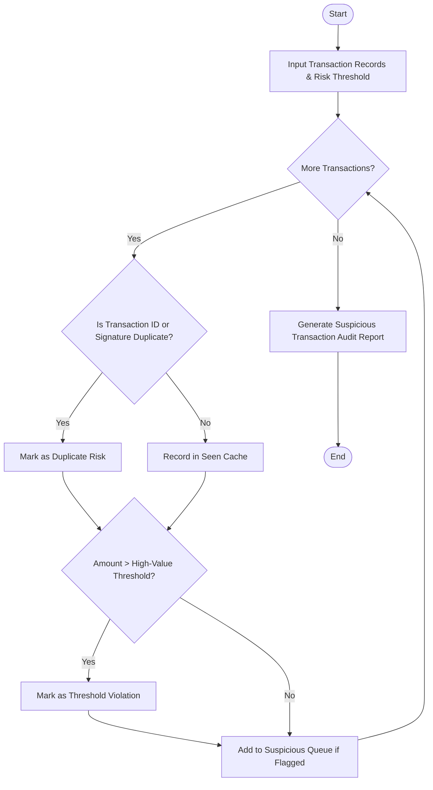

Here is a complete system design, algorithm, Mermaid flowchart, Python implementation, and sample test case for the **Repeated Transaction Detection System**.

---

## 1. Problem Statement

Payment gateways, banks, and e-commerce platforms process millions of transactions daily. Fraudsters and technical glitches often result in accidental double-charging, card-testing attacks (rapid duplicate small transactions), or unauthorized high-value fund transfers.

An automated monitoring system is required to process transaction streams, detect duplicate or repeated transactions (same identifier, or identical amounts by the same user), identify high-value threshold violations, and generate a consolidated list of suspicious entries for compliance review.

### **Rules & Mechanics:**

1. **Duplicate Detection:** Identify transactions that share the same Transaction ID or represent duplicate submissions (same user ID, amount, and timestamp/merchant).
2. **Threshold Violation:** Flag any single transaction whose amount exceeds a predefined high-value risk threshold (e.g., ₹1,00,000 or $1,000).
3. **Suspicious Compilation:** Aggregate all flagged entries (duplicates and threshold violations) into an actionable suspicious transaction audit queue with specific risk reasons.

---

## 2. Algorithm

1. **Initialize Inputs:** Load transaction records (transaction ID, user ID, amount, merchant, timestamp) and system parameters (high-value threshold limit).
2. **Scan for Duplicates:**
* Maintain a tracking record of seen transaction IDs and unique user-amount signatures.
* If a duplicate Transaction ID or identical transaction signature appears, flag it as a **Duplicate Transaction**.


3. **Scan for Threshold Violations:**
* For each transaction, check if `amount > threshold`.
* If true, flag it as a **High-Value Threshold Violation**.


4. **Compile Suspicious Entries:** Merge all flagged items into a prioritized review list.
5. **Generate Audit Report:** Format and output the final suspicious transaction analysis statement.

---

## 3. Flowchart (Mermaid)



---


## 5. Sample Input & Output

### **Sample Input Configuration**

* **High-Value Risk Threshold:** `₹75,000.00`
* **Transaction Stream:**
1. `TXN-9001` | User `U-101` | ₹4,500.00 | ElectroMart
2. `TXN-9002` | User `U-102` | ₹82,000.00 | LuxuryCars (Exceeds threshold)
3. `TXN-9003` | User `U-103` | ₹1,200.00 | QuickCoffee
4. `TXN-9004` | User `U-101` | ₹4,500.00 | ElectroMart (Exact duplicate parameters as TXN-9001)
5. `TXN-9002` | User `U-102` | ₹82,000.00 | LuxuryCars (Exact duplicate Transaction ID & high value)
6. `TXN-9005` | User `U-104` | ₹1,20,000.00 | GlobalJewels (Exceeds threshold)


---

### **Sample Output Audit Report**

```text
==================================================
        REPEATED TRANSACTION & FRAUD DETECTION
==================================================
Total Transactions Processed : 6
High-Value Threshold Limit   : ₹75,000.00
Clean Transactions Verified  : 2
Suspicious Entries Flagged   : 4
--------------------------------------------------
SUSPICIOUS TRANSACTION AUDIT QUEUE
--------------------------------------------------
1. Txn ID: TXN-9002 | User: U-102 | Amount: ₹82,000.00
   Merchant  : LuxuryCars | Time: 10:18:05
   Risk Flags: High-Value Threshold Violation (₹82,000.00 > ₹75,000.00) 🚨
2. Txn ID: TXN-9004 | User: U-101 | Amount: ₹4,500.00
   Merchant  : ElectroMart | Time: 10:22:40
   Risk Flags: Repeated Identical Payment (Possible Double-Charge) 🔄
3. Txn ID: TXN-9002 | User: U-102 | Amount: ₹82,000.00
   Merchant  : LuxuryCars | Time: 10:25:11
   Risk Flags: Duplicate Transaction ID ⚠️; Repeated Identical Payment (Possible Double-Charge) 🔄; High-Value Threshold Violation (₹82,000.00 > ₹75,000.00) 🚨
4. Txn ID: TXN-9005 | User: U-104 | Amount: ₹120,000.00
   Merchant  : GlobalJewels | Time: 10:30:00
   Risk Flags: High-Value Threshold Violation (₹120,000.00 > ₹75,000.00) 🚨
==================================================

```
