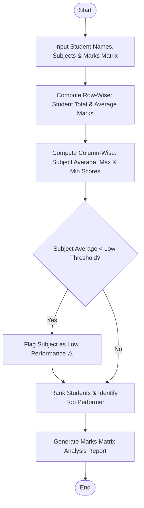

Here is a complete system design, algorithm, Mermaid flowchart, Python implementation, and sample test case for the **Student Marks Matrix Analysis System**.

---

## 1. Problem Statement

Educational institutions and examination boards require multi-dimensional analytical tools to evaluate academic performance across large cohorts. When student scores are represented as a matrix (rows corresponding to students and columns corresponding to subjects), manual analysis becomes tedious.

An automated marks matrix analysis system is required to process 2D student-subject grade matrices, compute row-wise statistics (total and average marks per student), calculate column-wise statistics (average and distribution per subject), identify top-performing students, and flag subjects where average performance falls below a critical passing threshold.

### **Rules & Mechanics:**

1. **Row-Wise Computation:** Calculate total marks and percentage/average for each student across all subjects.
2. **Column-Wise Computation:** Calculate the average class score, highest score, and lowest score for each subject.
3. **Top Performer Identification:** Rank students by total/average marks and select the highest-scoring candidate(s).
4. **Low Performance Detection:** Flag any subject whose class average score falls below a predefined threshold (e.g., $< 65.0$).

---

## 2. Algorithm

1. **Initialize Inputs:** Load student names, subject headings, and the 2D matrix of marks.
2. **Compute Row-Wise Statistics:**
* For each student, sum the row values to find `Total Marks`.
* Compute `Average Score = Total Marks / Number of Subjects`.


3. **Compute Column-Wise Statistics:**
* For each subject column, compute the class average, maximum mark, and minimum mark.


4. **Evaluate Subject Performance:**
* Check if any subject's average is below the low-performance threshold. If so, flag it for faculty review.


5. **Identify Top Performer:** Sort or scan row totals to determine the student(s) with the highest aggregate performance.
6. **Generate Audit Report:** Format and output the complete statistical matrix breakdown.

---

## 3. Flowchart (Mermaid)



---

## 5. Sample Input & Output

### **Sample Input Configuration**

* **Subjects:** `Mathematics`, `Physics`, `Chemistry`, `Computer Science`
* **Low Performance Threshold:** `70.0%` average
* **Students & Marks Matrix (5 Students × 4 Subjects):**
* Alice Smith: `[88, 92, 90, 95]`
* Bob Jones: `[65, 58, 62, 70]`
* Charlie Brown: `[78, 85, 80, 82]`
* Diana Prince: `[95, 94, 96, 98]`
* Evan Wright: `[72, 68, 65, 74]`


---

### **Sample Output Analysis Report**

```text
==================================================
           STUDENT MARKS MATRIX ANALYSIS
==================================================
Total Students Evaluated : 5
Total Subjects Assessed  : 4
Low Performance Threshold: 70.0%
--------------------------------------------------
STUDENT PERFORMANCE SUMMARY (ROW-WISE)
--------------------------------------------------
- Alice Smith     | Total: 365.0  | Average: 91.25% | Marks: [88, 92, 90, 95]
- Bob Jones       | Total: 255.0  | Average: 63.75% | Marks: [65, 58, 62, 70]
- Charlie Brown   | Total: 325.0  | Average: 81.25% | Marks: [78, 85, 80, 82]
- Diana Prince    | Total: 383.0  | Average: 95.75% | Marks: [95, 94, 96, 98]
- Evan Wright     | Total: 279.0  | Average: 69.75% | Marks: [72, 68, 65, 74]
--------------------------------------------------
SUBJECT PERFORMANCE SUMMARY (COLUMN-WISE)
--------------------------------------------------
- Mathematics  | Avg: 79.6%  | Max: 95  | Min: 65 [Healthy ✅]
- Physics      | Avg: 79.4%  | Max: 94  | Min: 58 [Healthy ✅]
- Chemistry    | Avg: 78.6%  | Max: 96  | Min: 62 [Healthy ✅]
- Computer Sci | Avg: 79.8%  | Max: 98  | Min: 70 [Healthy ✅]
--------------------------------------------------
COHORT HIGHLIGHTS
--------------------------------------------------
Top Performing Student : Diana Prince with 383.0 total marks (95.75%) 🌟
Flagged Weak Subjects  : None
==================================================

```
